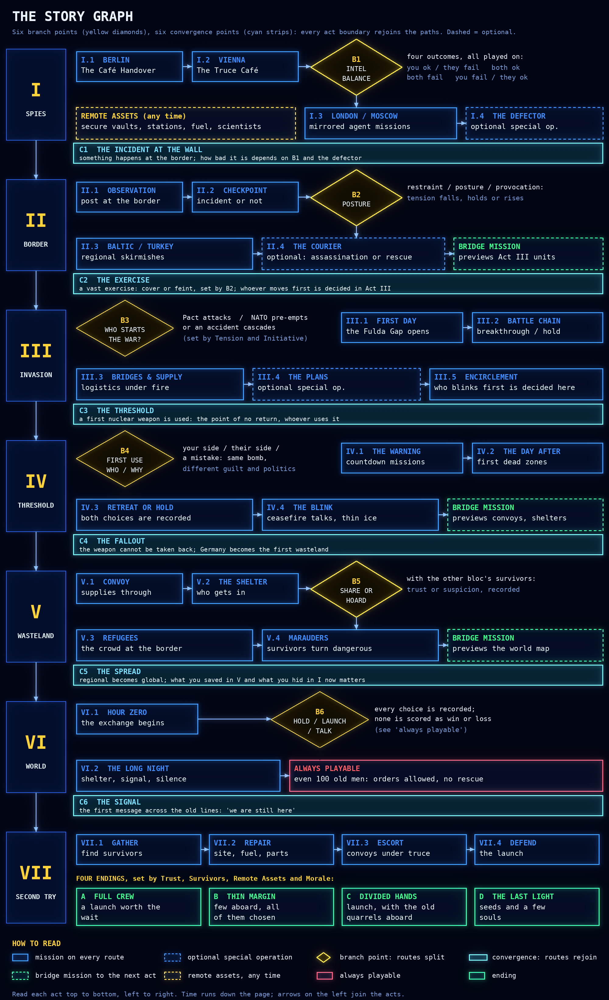

# Thin Ice (working title): story skeleton, draft 1

**Summary.** This is the fixed frame of the campaign: seven acts, six branch points, six convergence points and four endings. It decides _where the story can go_ and what each result routes to, but not what any single mission contains. Every act boundary is a convergence point, so the paths always rejoin and the number of missions stays manageable. Both blocs play the same graph in mirrored form, and neither is favoured. It is a proposal for you to lock, change or reject one branch point at a time. No code exists, and none will start before the new repository is created.

## Principles of the skeleton

* **A braid, not a tree.** Branches happen inside an act and rejoin at its end, so every path reaches every act. The differences carry forward as state, not as separate stories.
* **Every mission continues the story,** whatever the result. No result ends the campaign, and every route can reach the colony ship in Act VII.
* **Both sides, equal chances.** The graph is the same for the West and the East. Either bloc can be the aggressor at B3, and absent a decisive imbalance both end up in the same place.
* **Consequences are felt later, not reported.** A branch changes the next missions, through intel, morale, supply and who trusts whom.
* **The war is hard to stop, and that is the point.** De-escalation can work for a while, but every success is fragile (see decision D1).
* **The results of the war are never a joke.** Everything around them can be, and the humour gets drier as the stakes rise, until the ending, which is sincere.
* **Enemies are people,** with names and small human details, and the game resists the official line of both blocs.

## State variables that routes depend on

| Variable | Meaning | Moves with |
|---|---|---|
| Tension | How close the blocs are to war | Incidents, posture, provocation, spy results |
| Initiative | Who is better placed to strike first | Exercises, readiness, intel balance, who was provoked |
| Escalation | How far weapons have gone (conventional, tactical nuclear, strategic) | Battle results, political support, who blinks |
| Intel balance | How much each side knows of the other | Spy missions, agents, the enemy's losses (partial and ageing) |
| Trust | Trust between and inside the blocs | Honest dealing, shared supplies, civilian harm, defections |
| Home front and political support | What the public and leaders will allow | Casualties, news, results, leaks |
| Force and morale | Surviving units, veterans, equipment and their morale | Every mission result, rest, supply, reserves |
| Civilian harm | How much damage was done to the people caught in it | Methods chosen in missions and at branch points |
| Ark assets | Things secured in remote places (seed vault, polar station, fuel, aircraft, scientists) | Optional remote-asset orders from Act I on |
| Survivors | People who live to Act VII | Shelter, sharing, evacuation, what you did in Act VI |

# The six branch points

|  | Question | Decided by | Routes | What changes afterwards |
|---|---|---|---|---|
| B1 (Act I) | Who knows more about whom? | The double spy mission and how earlier agents fared | You succeed, they fail / both succeed / both fail / you fail, they succeed | Starting intel and ambush risk in Act II; how tense the border is |
| B2 (Act II) | How do you behave at the border? | Rules of engagement you choose, B1, home front | Restraint / posture / provocation | Tension, and whether the exercise at C2 is a cover or a feint |
| B3 (Act III) | Who starts the war? | Tension, Initiative, the exercise, your decisions | The East attacks / the West pre-empts / an accident cascades | Which side holds the first-day advantage; who is defending; the tone of the early battles |
| B4 (Act IV) | Who uses the first nuclear weapon, and why? | Battle results (who blinks), political support, escalation, trust | Your side / their side / a mistake or a rogue commander | Guilt and politics afterwards, how fast the fallout spreads |
| B5 (Act V) | Do you share or hoard? | Supplies, morale, trust, the refugees at the door | Share / split / hoard | Trust, number of survivors, who stands beside you in Act VII |
| B6 (Act VI) | Hold fire, launch or talk? | What is left to you; the choices are never scored as win or loss | Hold / launch / open talks | Trust and survivors; the tone of Act VII |

## The six convergence points

|  | Name | What is guaranteed whatever the route |
|---|---|---|
| C1 | The incident at the wall | Something happens at the border. Its size and who is blamed depend on B1 and the defector |
| C2 | The exercise | A vast exercise starts near the border. It is either cover for an attack or a feint, depending on B2 |
| C3 | The threshold | A first nuclear weapon is used. Who uses it, and why, is decided at B4 |
| C4 | The fallout | The weapon cannot be taken back, and Germany becomes the first wasteland |
| C5 | The spread | The regional war becomes global. What you saved in Act V, and what you hid from Act I on, now matters |
| C6 | The signal | The first message crosses the old lines: 'we are still here'. Act VII begins |

# Act by act

| Act | Setting and look | Missions (est.) | Optional and bridge missions | Humour register |
|---|---|---|---|---|
| I Spies | Berlin, Vienna, London, Moscow, Geneva; painted close view, 4 to 8 agents | 8 to 10 | The defector; remote-asset orders at any time | Playful: cover identities, the cheese inspector, the truce café |
| II Border | Fulda sector, the Baltic, Turkey; terrain map, platoons and single vehicles | 8 | The courier (assassination or rescue); a bridge mission previewing Act III | Dry: the checkpoint paperwork, the weather report |
| III Invasion | The Fulda Gap; hex map, platoons and companies | 10 to 12 | The plans (special op.) | Gallows: the Ministry of Optimism, 'supplies are ambitious' |
| IV Threshold | Contested zones; operational map with warnings | 6 | A bridge mission previewing convoys and shelters | Very dark and dry; the narrator keeps explaining how to stay calm |
| V Wasteland | Germany contaminated; survival map, convoys and shelters | 8 | A bridge mission previewing the world map | Human: the mandatory-fun officer's talent show; never about the dead |
| VI World | Defcon-like world map; assets, not units | 3 to 4 | None. This act is always playable | Black: the DJ reads dedications and the weather of places that have none |
| VII Second Try | A launch site and the world logistics map; former enemies work together | 6 | None | Warm: the naming committee, the seating dispute. The last joke is sincere |

## Special operations in the middle acts

* **The defector (I.4):** protect or hand over. The choice changes Trust and the size of the incident at C1.
* **The courier (II.4):** an assassination attempt on a political or military figure, or the chance to rescue him. It can delay or trigger escalation, and it carries moral weight: neither choice is made easy, and the story shows what each one costs.
* **The plans (III.4):** steal or protect invasion plans, in the painted Commandos-style view, with a result that feeds the first days of the battle chain.

## Bridge missions

My decision, as you left it to me: the acts stay clean and separate in their gameplay, and each act ends with one short bridge mission that previews the next act's units and look, so the change of scale is introduced and not sudden.

## Remote assets

From Act I the player may send agents or small assets anywhere on the global map. Each of the following is a long-term investment that pays off in Act VII: a seed vault, a polar station, fuel caches, a few aircraft, scientists, a library, a hospital ship. Nothing is announced when they are placed. The enemy may find them, which makes them risky.

## The four endings

|  | Name | Determined by | What it is |
|---|---|---|---|
| A | Full crew | High Trust, many survivors, most remote assets intact, steady morale | A launch worth the wait |
| B | Thin margin | Few survivors but good Trust and assets | Few aboard, every one of them chosen |
| C | Divided hands | Low Trust, mixed survivors and assets | The ship launches, with the old quarrels aboard |
| D | The last light | Very few survivors, assets partly lost | Seeds and a few souls: the smallest possible launch |

All four end with the ship leaving, because Act VII is always possible. What differs is who is aboard, and what the last scene says about how they got there.

## Recurring cast (neutral, one on each side)

* **The handler:** a dry, tired voice who briefs you in every act and is never fooled by the paperwork.
* **The counterpart:** a rival agent on the other side whom you meet at the Vienna truce café. They return in later acts as an enemy, a source and finally, depending on Trust, a partner in Act VII. This is where the 'trust seed' is planted.
* **Mr. Hendricks from Accounting:** audits your expenses in every act, even after the bombs, and becomes the most necessary person alive. A matching auditor exists on the other side.
* **The DJ:** the radio voice of Act VI, reading dedications.
* **The mandatory-fun officer:** runs the shelter's talent show in Act V.
* **The defector and the courier:** people, not symbols, with names and small human details.

## Mirror structure

|  | West campaign | East campaign |
|---|---|---|
| Same | The graph, branch points, state variables and endings | The graph, branch points, state variables and endings |
| Tools | Alliance cohesion, air power, public opinion | Discipline, mass, central control, the weight of the party line |
| Texture | The press, committees, coalition friction | Reports that say what they must, quotas, the informant on every floor |
| Humour | Bureaucratic and self-satisfied | Bureaucratic and fearful. Different shape, same target: institutions, never the dead |

## Volume and effort (honest estimate)

* About 50 missions per playthrough, at 30 to 60 minutes each: roughly 25 to 45 hours.
* Branches add variants, not whole new stories. I'd expect about 70 authored missions per side, with around 60% of the content shared by both sides.
* The skeleton is data, so every route can be walked by an automated test that checks no path dead-ends and Act VII is always reachable.

# Decisions I need from you

|  | Decision | My proposal |
|---|---|---|
| D1 | Can the war be avoided entirely? | No. De-escalation can delay it and change its shape, but each success is fragile. This fits 'thin ice' and 'show how brutal war is'. The alternative is one rare hidden path that avoids it. |
| D2 | Is 'an accident cascades' a good third answer at B3? | Yes. It is the most thematic one: nobody wanted this, and everybody is to blame. |
| D3 | How hard should the courier mission (II.4) push the moral weight? | Both choices have clear costs. A refusal is also an option, and has its own. |
| D4 | Are four endings right? | Four is enough, because Act VII always ends in a launch. |
| D5 | Which remote assets, and does each unlock something in Act VII? | Seven types as above, each adding something specific to the ship. |
| D6 | Are bridge missions at the end of Acts II, IV and V a good idea? | Yes; Acts I, III, VI and VII lead straight on. |
| D7 | Should the first mission stay Berlin, with the West first? | Yes, with the East as a mirrored switch. |
| D8 | Which of the six branch points do you want to change first? | Your call. B3 and B4 matter most for tone. |

## What this means for the vertical slice

The slice mission, 'The Café Handover', is node I.1 of the graph. Its outcomes route to I.2 and feed B1, so the interlude after it already has a real place in the story.

## A reminder

**The new repository still has to be created before any development work.** Documents, graphs and mock-ups can continue until then.

